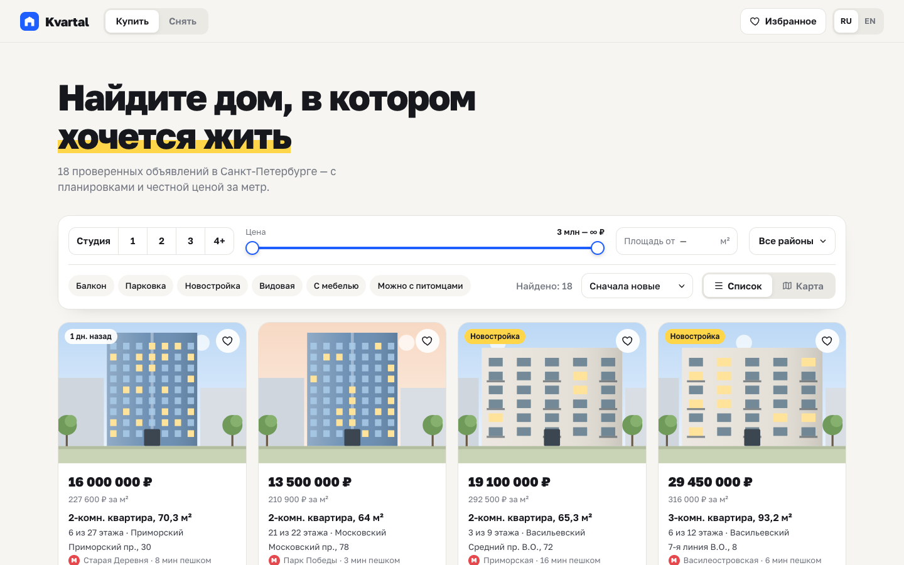
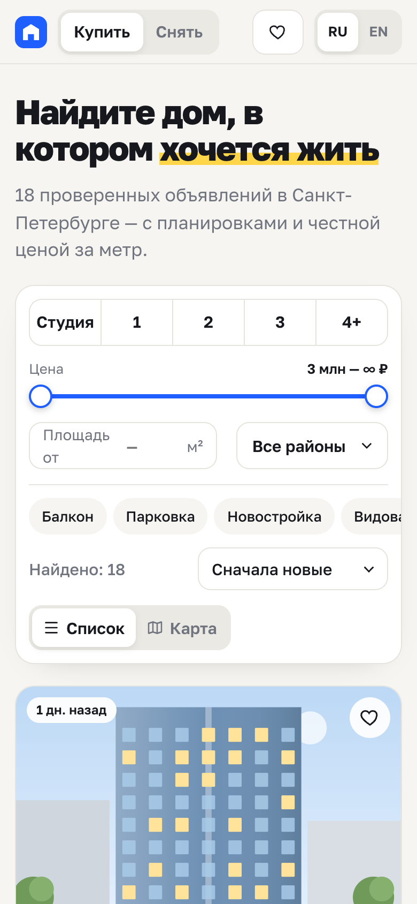

<div align="center">

# Kvartal

**Сервис поиска недвижимости** · RU / EN

<a href="https://cdduke.github.io/kvartal-estate/"></a>

   

&nbsp;

*🇬🇧 Real-estate catalogue — URL-synced filters, SVG city map with price pins, generated floor plans, mortgage calculator, compare.*

</div>

---

Концепт маркетплейса квартир в Санкт-Петербурге: каталог с фильтрами, карта с метками цен,
страница объекта с **генерируемой планировкой**, ипотечный калькулятор и сравнение объектов.
**Двуязычный интерфейс: русский (по умолчанию) и английский.**

**Стек:** React 19 · TypeScript (strict) · Vite · CSS без фреймворков · без внешних API и изображений

## Возможности

- **Фильтры**: покупка/аренда, комнаты (мультивыбор), двойной слайдер цены, площадь, районы (выпадающий список
  с чекбоксами), удобства, сортировка; счётчик результатов и пустое состояние
- **Состояние поиска в URL** (`?rooms=1,2&d=center&view=map`) — ссылкой на поиск можно поделиться,
  а страница объекта открывается по `#/p/12` и закрывается кнопкой «назад» браузера
- **Карта города на SVG**: районы, река, дороги, метки с ценами; наведение на метку подсвечивает карточку и наоборот;
  метки доступны с клавиатуры
- **Иллюстрации фасадов** (4 типа домов) и **генератор планировок** под количество комнат и площадь
- **Ипотечный калькулятор**: первый взнос, ставка, срок → аннуитетный платёж, переплата, диаграмма
- **Сравнение** до 3 объектов с подсветкой лучших значений; избранное в `localStorage`; форма записи на просмотр с валидацией
- Локализация: тексты, валюта и числа через `Intl` (компактные цены «16 млн»)

## Качество

- Проверено на 390px и 1440px сценарием в headless Chrome (фильтр → URL, сравнение, планировка, ипотека, Esc)
- На мобильных пойманы и исправлены два классических бага переполнения: grid-элементы с `min-width: auto`
  и nowrap-строка во flex-контейнере
- Детерминированная генерация данных — одинаковый каталог у всех посетителей

## Запуск

```bash
npm install
npm run dev      # http://localhost:5181
npm run build    # tsc + сборка
```

---

*Real-estate concept built as a portfolio piece. Listings, agents and prices are generated. Bilingual: Russian / English.*


**Демо:** https://cdduke.github.io/kvartal-estate/
